# Лабораторная работа №3. Bubble

**Тема приложения:** «Каталог рецептов»
**Автор:** Ульяна Казак

---

## 1. Краткое описание выполненного

Я создала веб-приложение «Каталог рецептов» на платформе Bubble.

- **Часть 1.** С помощью AI-агента Bubble сгенерирован каркас: страницы `index`, `my_recipes`, `recipe_detail`, `reset_pw`, `404`, общие блоки Header и Footer (Web Reusables), тип данных «Рецепт», каталог с поиском и фильтрами, CRUD для рецептов, авторизация. В футере указана строка «ТВП: Казак».
- **Часть 2.** По сгенерированному Build Guide «Избранное» добавлена возможность сохранять рецепты в избранное: поле `Favorite Recipes` (список «Рецепт») у типа User и кнопка на странице `recipe_detail`.
- **Часть 3.** Вручную, без AI: изменён заголовок в Header, создана Global variable цвета `Primary_color`, создан стиль `btn-favorite`, использующий эту переменную, добавлен готовый компонент из библиотеки. 
- **Часть 4.** Создана новая сущность `review` с полями Новый тип содержит 7 полей:
comment — текст отзыва
rating — число, оценка 1–5
cooked_on — дата приготовления
would_cook_again — да/нет
photo — изображение готового блюда
recipe — ссылка на «Рецепт»
author — ссылка на User,
добавлены записи, на новой странице `reviews` реализован полный CRUD отдельными workflows.
- **Часть 5.** Ачивка «Plugins»: плагин Bootstrap Star Rating Input, оценка рецепта звёздами на странице `recipe_detail`.

## 2. Промпт (Часть 1, дословно)

```
Создай приложение на тему «Каталог рецептов»
Пусть этот сайт будет публичный
Страницу обязательно создай по структуре header + body + footer
Обязательно укажи в заготовке следующую строку: «ТВП: Казак»
Добавь несколько интерактивных элементов (реализующих CRUD)
```

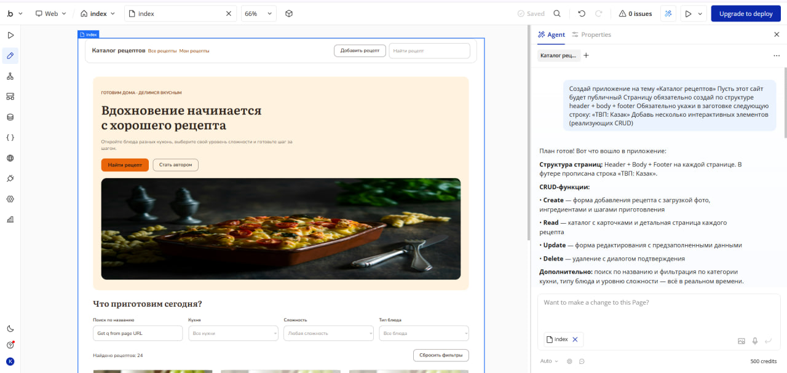

## 3. Ссылка на dev-версию приложения

**https://my-app-261010-60315.bubbleapps.io/version-test/recipe_detail/1791619316913x748615939706979000?debug_mode=true**

## 4. Использованные AI-промпты (дословно)

1. **Часть 1 (каркас приложения)** — см. раздел 2.
2. **Часть 2 (генерация Build Guides)** — **Каталог рецептов с поиском и фильтрами по кухне и сложности, избранным и списком покупок с полным CRUD (создание, просмотр, редактирование, удаление)**
3. **Часть 4.1 (название и поля новой сущности)** — **Придумай Data Type для кулинарного приложения. Название сущности и минимум 4 поля разных типов (текст, число, дата, да/нет, изображение и т.д.). Назови поля на русском или английском.**
4. **Часть 4.2 (UI новой страницы с CRUD)** — **Создай новую страницу "reviews" для работы с Data Type "Отзыв". На странице должно быть: - Список всех отзывов (Repeating Group) - Кнопка "Добавить отзыв" - Форма для создания нового отзыва (поля: comment, rating, cooked_on, would_cook_again, photo, recipe) - Возможность редактировать существующий отзыв - Кнопка удаления отзыва Сделай полный CRUD: - Create — создание нового отзыва - Read — отображение списка - Update — редактирование - Delete — удаление Каждое действие должно быть отдельным workflow.**

Дополнительно для пошаговых подсказок по интерфейсу Bubble я использовала ИИ-ассистента (Claude).

## 5. Освоенные элементы и workflows

### Часть 2. Исследование идеи

Изучен Build Guide «Избранное» (сгенерирован по моему запросу).

- **Что посмотрела:** гайд предлагает хранить избранное в поле-списке у пользователя, добавить на страницу рецепта кнопку и два workflow (добавить / убрать).
- **Что показалось полезным:** схема «поле-список `Favorite Recipes` у User» — избранное у каждого пользователя своё.
- **Что взято в приложение:** поле `Favorite Recipes` у User и кнопка «В избранное» на `recipe_detail`.
- **Отличия от гайда:** вместо двух workflow сделан один с операцией **toggle**; условие видимости кнопки изменено так, чтобы она была видна любому вошедшему пользователю, а не только автору рецепта.

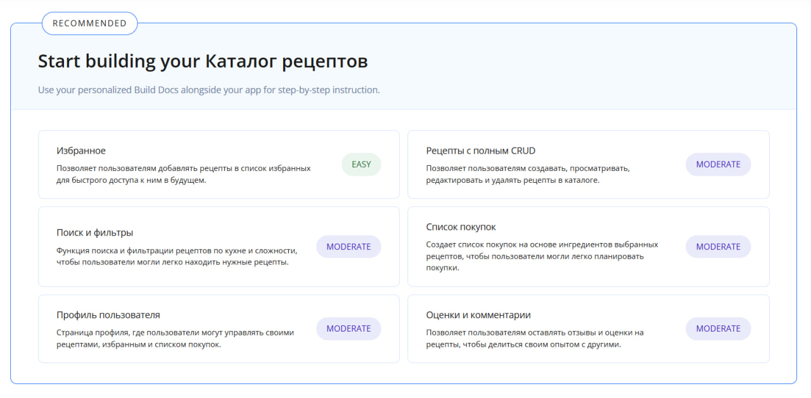
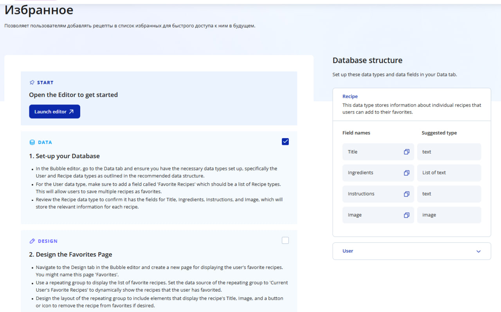

**До:**

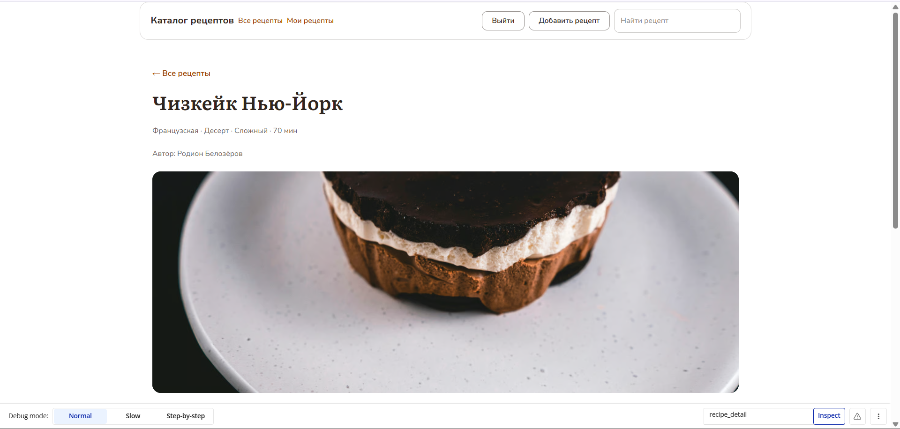

**После:**

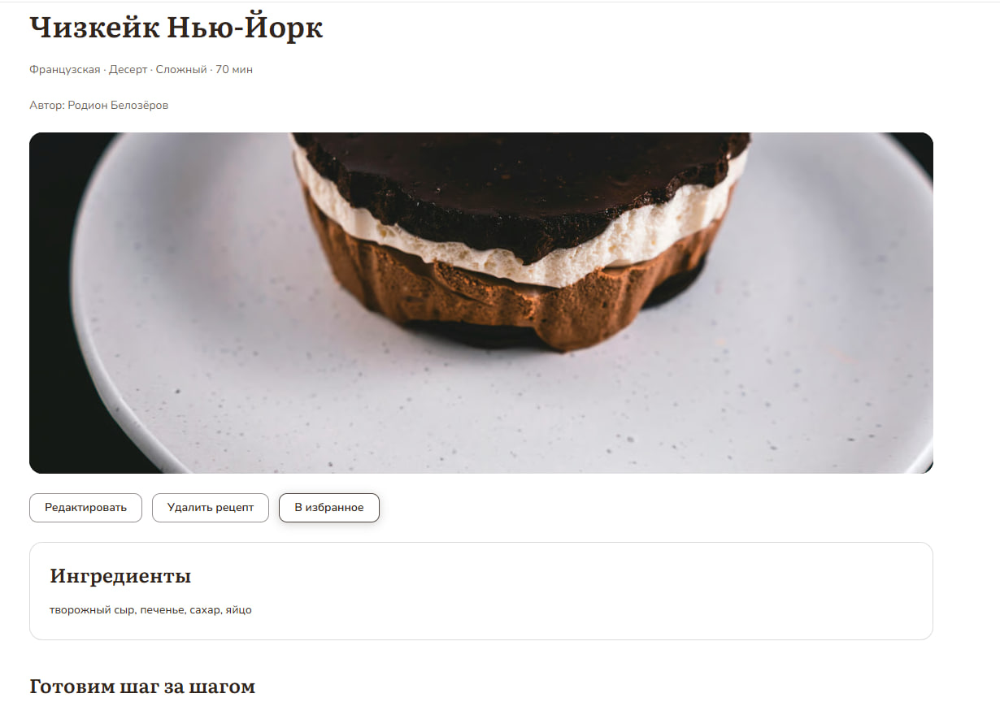
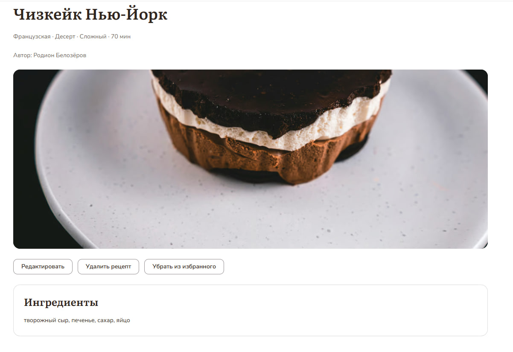

**Данные и логика:**

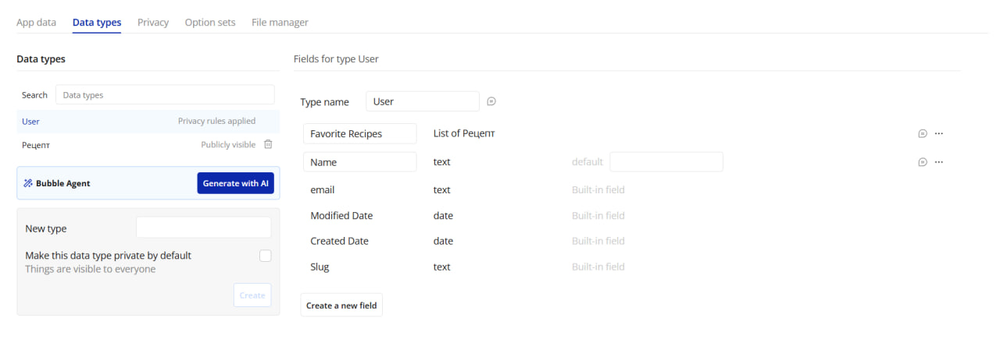
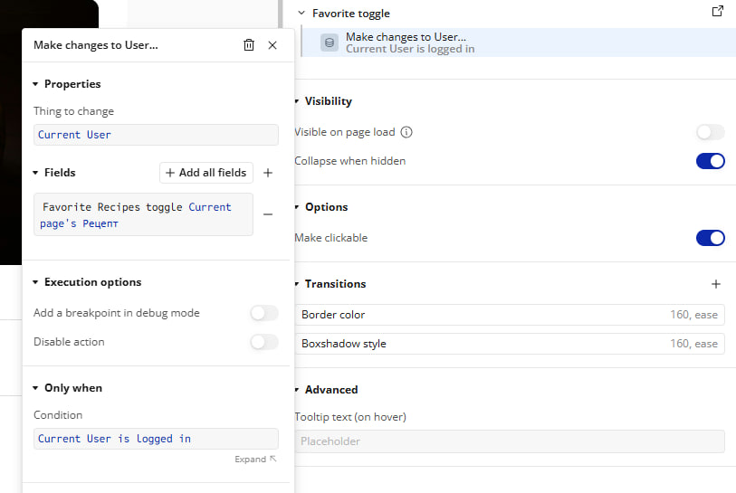
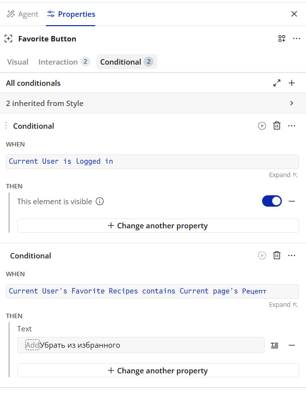
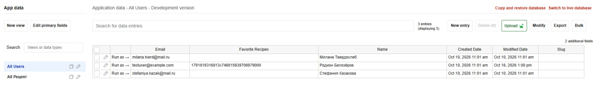

### Часть 3. Ручная доработка UI (без AI)

- **3.1 Заголовок.** В Header текст изменён на «Каталог рецептов - Ульяна Казак». Header — общий Reusable-элемент, поэтому изменение видно на всех страницах.
  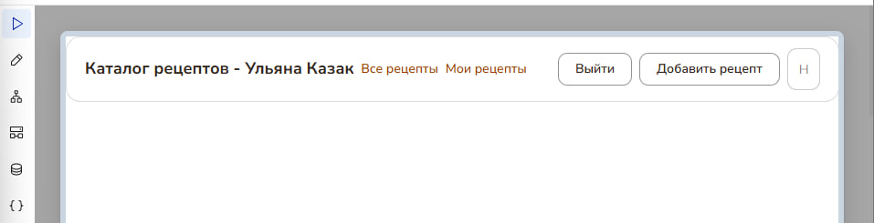
- **3.2 Global variable.** Создана переменная типа Color `Primary_color` (оранжевый цвет, как у акцентов сайта), применена к элементу.
  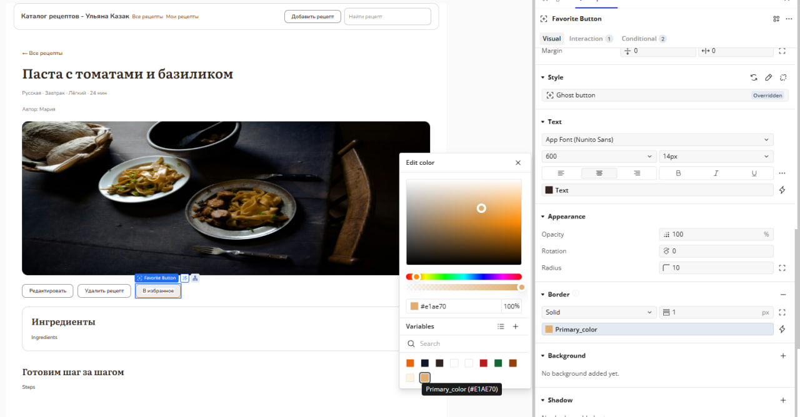
- **3.3 Стиль.** Создан стиль `btn-favorite` (тип Button). Его фон задан `Primary_color`; форма (радиус 10, шрифт 600 / 14px, отступы 10/18). Стиль применён к кнопке «В избранное». Стили hover и pressed остались стандартными.
  
- **3.4 Готовый компонент.** 
  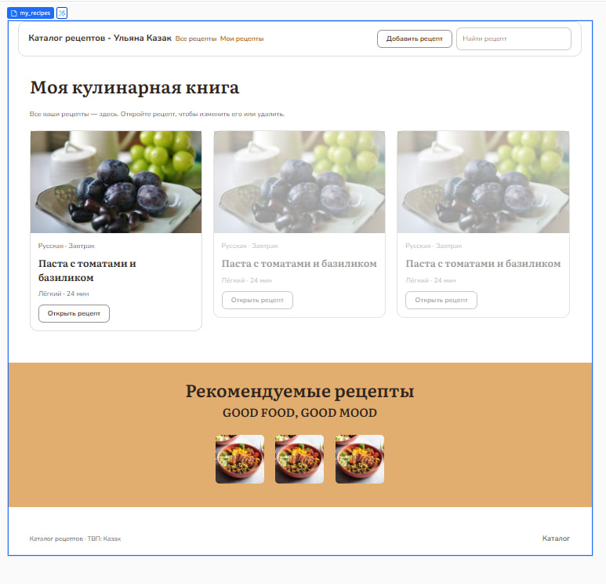

### Часть 4. Data и Workflows
 
**Сущность в Data.** Создан тип данных `Review` («Отзыв») — отзыв пользователя о приготовленном по рецепту блюде. Тип содержит 7 полей разных типов:
 
| Поле | Тип | Назначение |
|---|---|---|
| `comment` | text | текст отзыва |
| `rating` | number | оценка от 1 до 5 |
| `cooked_on` | date | дата приготовления |
| `would_cook_again` | yes/no | приготовит ли автор блюдо ещё раз |
| `photo` | image | фото готового блюда |
| `recipe` | «Рецепт» | ссылка на рецепт, к которому относится отзыв |
| `author` | User | ссылка на автора отзыва |
 
Поля `recipe` и `author` связывают отзыв с существующими типами данных, поэтому отзывы можно показывать на странице конкретного рецепта и фильтровать по автору. В App data вручную добавлено 2 записи.
 
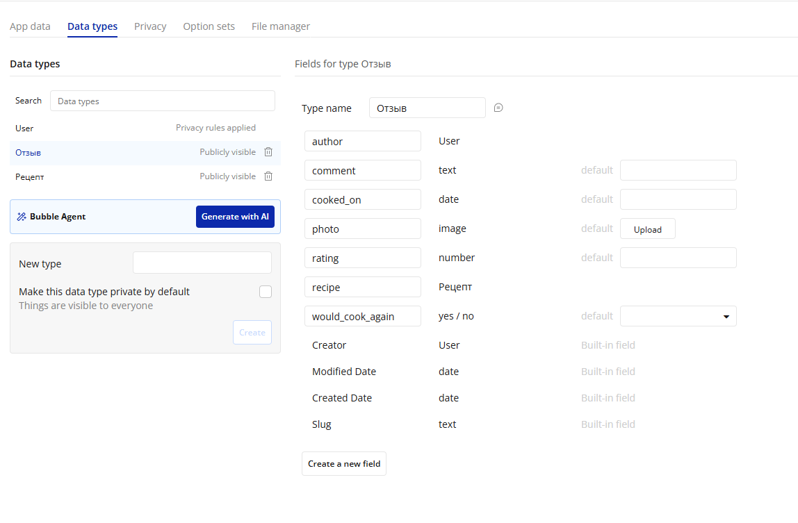

**CRUD на странице `reviews`.** Каждое действие реализовано отдельным workflow:

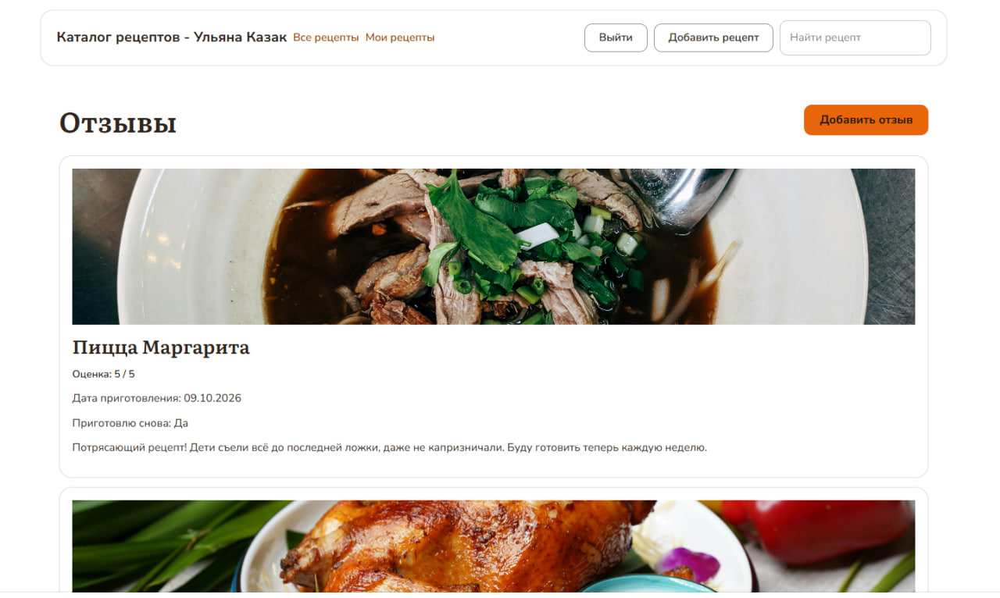
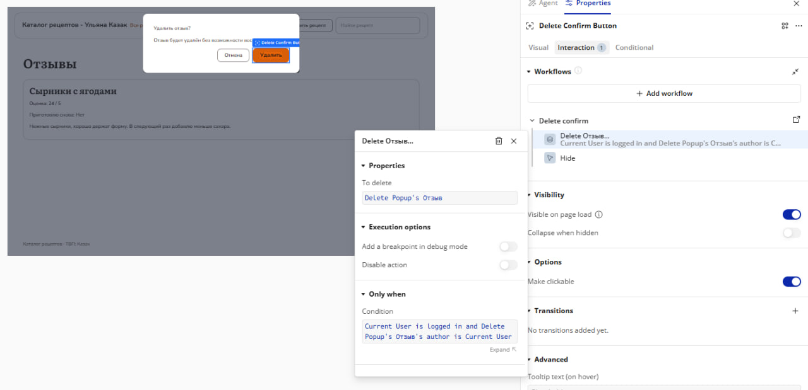


### Часть 5. Ачивка «Plugins»

**Плагин:** Bootstrap Star Rating Input (маркетплейс Bubble). Плагин добавляет элемент Star Rating — оценка рецепта кликом по звёздам.

**Как использован:** на странице `recipe_detail` под заголовком рецепта размещён элемент StarRating A.

1. В тип данных «Рецепт» добавлено поле `Рейтинг` (number).
2. В свойстве Initial content элемента указано `Current page's Рецепт's Рейтинг`, поэтому при загрузке звёзды показывают текущую оценку из базы.
3. Создан workflow `Rating change` с событием «StarRating A's value is changed». Действие «Make changes to a thing» меняет `Current page's Рецепт`, записывая в `Рейтинг` значение `This StarRating's value`.


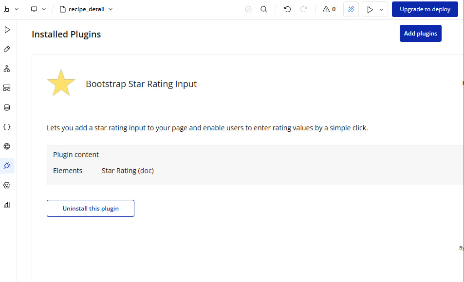
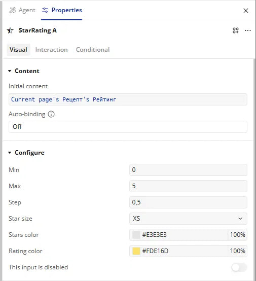
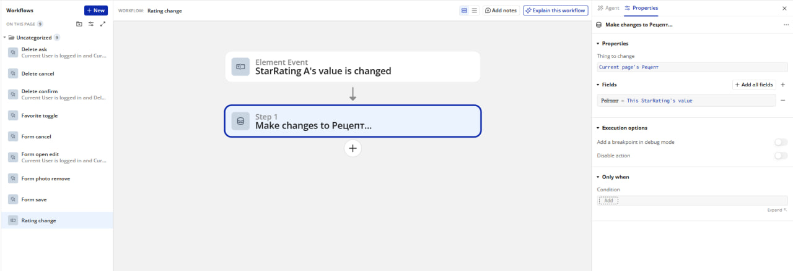
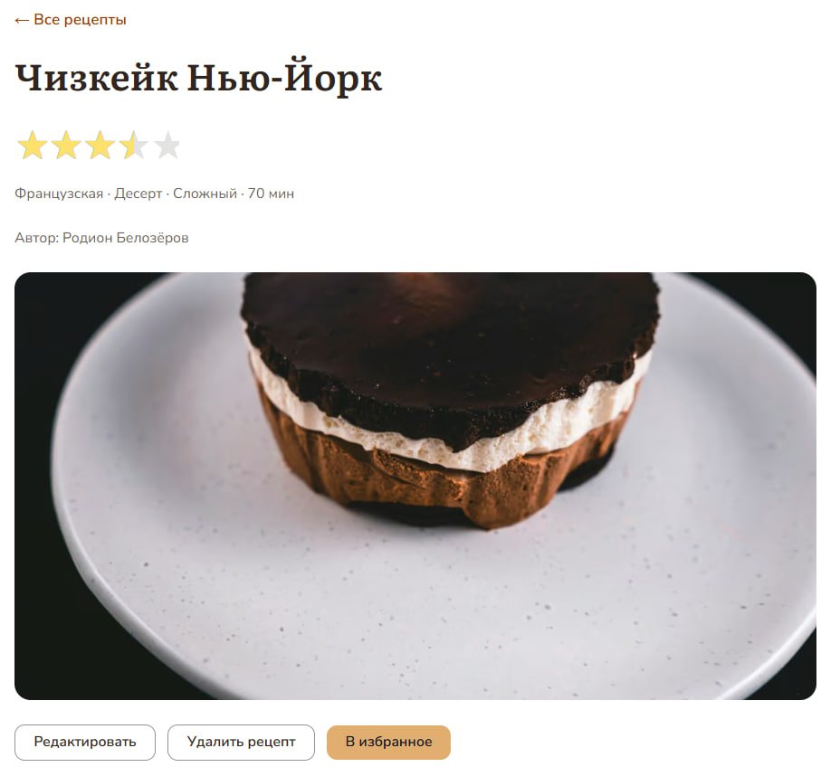


## 7. Выводы

В этой работе я научилась собирать приложение в Bubble: AI-агент создал каркас, а дальше я дорабатывала его сама. Я узнала как логика собирается из workflows и как Global variable и стили помогают менять оформление в одном месте.
