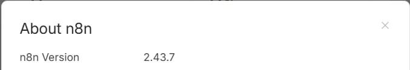
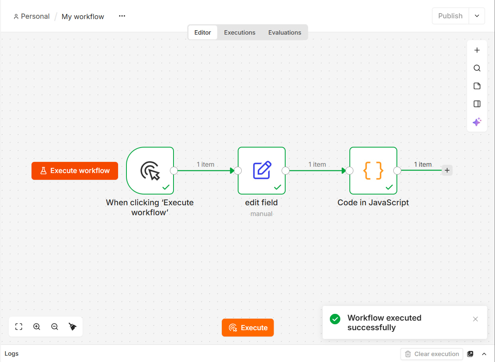
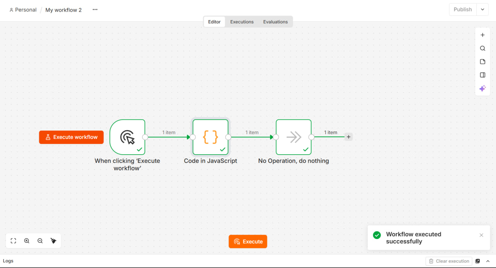
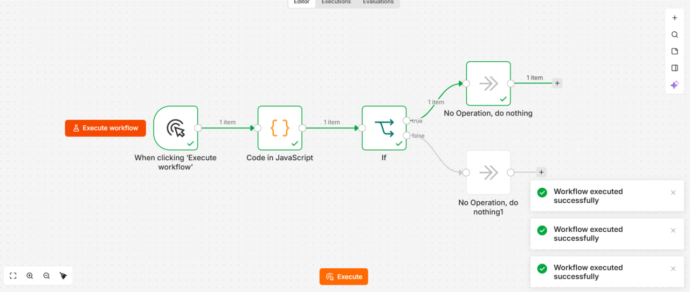
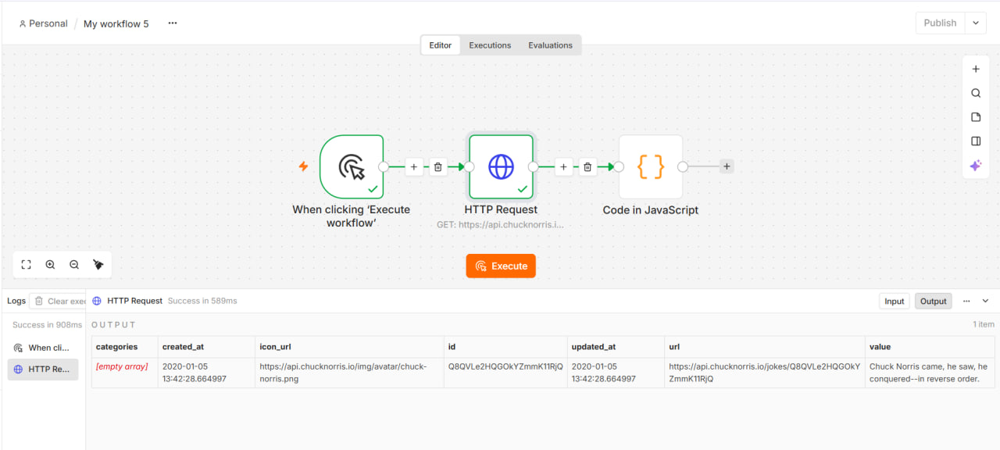
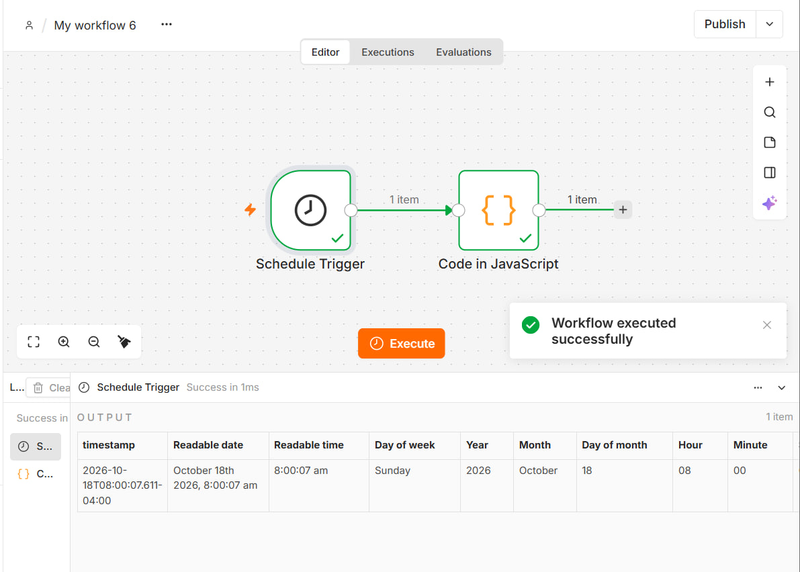
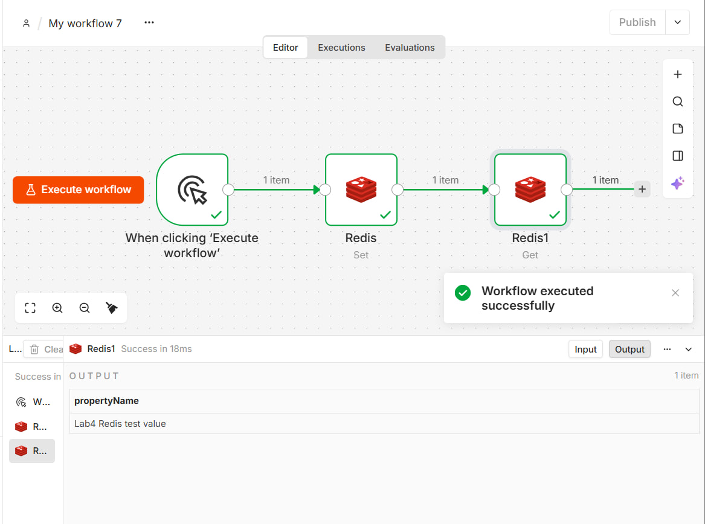
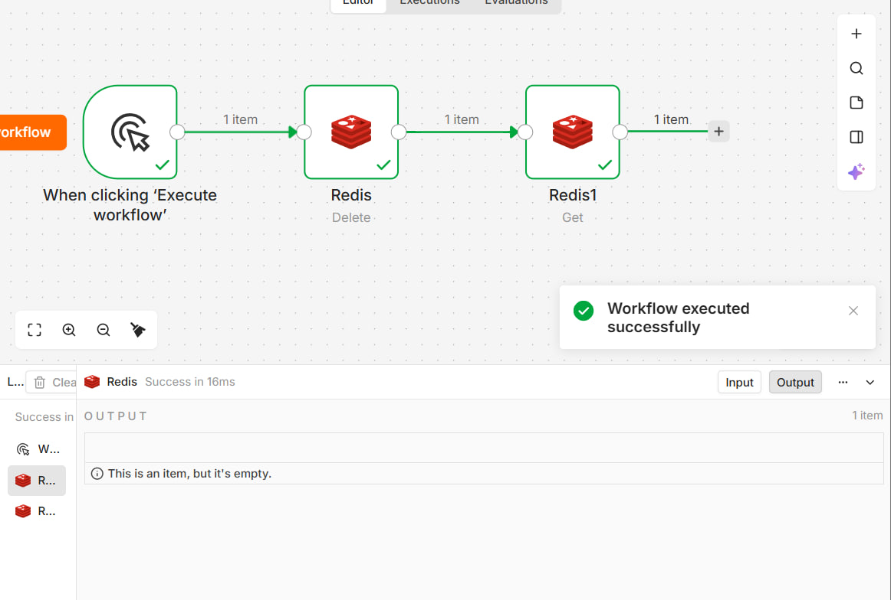
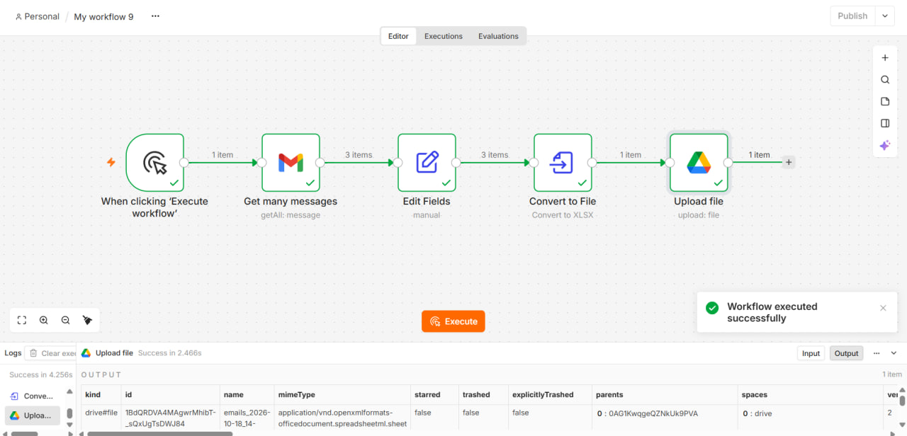
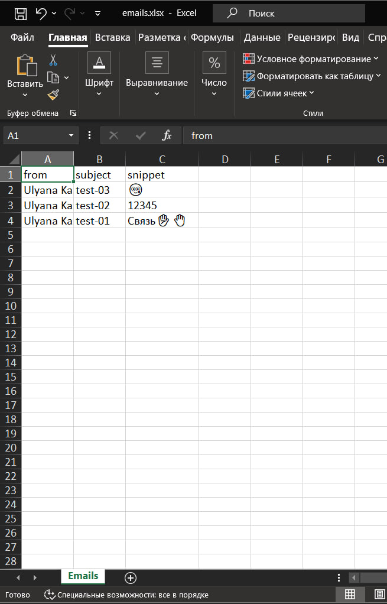

# Лабораторная работа №4. n8n

**Студент:** Казак Ульяна, группа УИР-241

## 1. Краткое описание выполненного

Освоена low-code платформа автоматизации n8n. n8n и Redis развёрнуты в изолированных Docker-контейнерах. Созданы workflow, которые демонстрируют базовые ноды, JavaScript в ноде Code, HTTP-запросы к публичному API, запуск по расписанию и работу с Redis (Set, Get, Delete, Exists).

## 2. Установка и запуск n8n

```bash
docker run -d --name n8n -p 5678:5678 \
  -v n8n_data:/home/node/.n8n \
  -v n8n_storage:/data \
  n8nio/n8n
```

| Параметр | Значение |
| --- | --- |
| Образ | `n8nio/n8n` |
| Порт | `5678:5678` |
| Volume 1 | `n8n_data` → `/home/node/.n8n` (настройки, база, профиль) |
| Volume 2 | `n8n_storage` → `/data` (пользовательские файлы) |
| URL | http://localhost:5678 |

После запуска открыт http://localhost:5678 и создан аккаунт владельца.



## 3. Освоенные ноды

- **Manual Trigger**: ручной запуск workflow.
- **Schedule Trigger**: запуск по расписанию (раз в минуту).
- **Edit Fields (Set)**: задание полей `payload`, `topic`, `timestamp`.
- **Code (JavaScript)**: let/const, массивы, объекты, цикл `for`, `if/else`.
- **IF**: ветвление по условию (`is greater than`).
- **HTTP Request**: GET-запрос к публичному API, ответ в JSON.
- **Redis**: операции Set, Get, Delete, Exists.
- **NoOp**: заглушка для завершения веток.

## 4. Использованные AI-промпты

- «Напиши JS-код для ноды Code в n8n, который берёт массив чисел, считает сумму через цикл for, проверяет условие через if/else и возвращает объект с полем payload».
- «Как в n8n настроить ветвление по числовому полю больше 50 в ноде IF?»
- «Как настроить свой проект в google cloude».

## 5. Workflow и скриншоты

Схемы лежат в `lab4/flows/`, скриншоты в `lab4/screenshots/`.

### 2.1. Manual Trigger → Set → Code
[flow-01-manual-set.json](../flows/flow-01-manual-set.json)



### 2.2. Manual Trigger → Code → NoOp
[flow-02-code.json](../flows/flow-02-code.json)



### 2.3. Manual Trigger → Code → IF → NoOp (true / false)
[flow-03-if.json](../flows/flow-03-if.json)



### 2.4. Manual Trigger → Set → Code
[flow-04-set.json](../flows/flow-04-set.json)

.png)

### 2.5. Manual Trigger → HTTP Request → Code
[flow-05-http.json](../flows/flow-05-http.json)



### 2.6. Schedule Trigger → Code
[flow-06-schedule.json](../flows/flow-06-schedule.json)



### 3.1. Redis: Set и Get
[flow-09-redis.json](../flows/flow-09-redis.json)



### 3.2. Redis: Delete и Exists
[flow-10-redis.json](../flows/flow-10-redis.json)



Подробное описание работы с Redis (запуск контейнера, credentials, шаги) в [redis.md](redis.md).

## 6. Ачивка 8.1. Gmail → Excel → Google Drive
 
Автоматизация с двумя Google-сервисами (Gmail и Google Drive): по ручному запуску собираются письма из ящика, превращаются в Excel-файл и загружаются на Google Диск.
 
Файл: [flow-11-gmail-excel.json](../flows/flow-11-gmail-excel.json)
 
`Manual Trigger` → `Gmail (Get many messages)` → `Edit Fields` → `Convert to File` → `Google Drive (Upload)`
 
| Нода | Настройки |
| --- | --- |
| Manual Trigger | Ручной запуск |
| Gmail | Message → Get Many, Limit 20, Simplify, поиск `in:inbox` |
| Edit Fields | Оставлены поля `from`, `subject`, `snippet` (`{{ $json.From }}`, `{{ $json.Subject }}`, `{{ $json.snippet }}`) |
| Convert to File | Convert to XLSX, поле `data`, файл `emails.xlsx`, лист `Emails` |
| Google Drive | File → Upload, поле `data`, имя `emails_{{ $now.toFormat('yyyy-LL-dd_HH-mm') }}.xlsx`, корень «Мой диск» |
 
Для доступа к сервисам создан проект в Google Cloud, включены Gmail API и Google Drive API, настроен OAuth-клиент, а в n8n созданы credentials Gmail OAuth2 и Google Drive OAuth2. Использован тестовый Gmail-аккаунт.
 

 


## 7. Выводы

В работе я установила n8n и Redis в Docker и собрала workflow на основных нодах. Визуальная сборка удобна для связывания шагов, а нода Code нужна там, где логику проще написать на JavaScript. n8n в контейнере обращается к Redis через `host.docker.internal`, потому что `localhost` внутри контейнера указывает на сам контейнер, а не на хост.
