# Лабораторная работа №5. Чат-боты

**Студент:** Казак Ульяна, группа СДП-УИР-241
**Трек:** C — Typebot

---

## 1. Краткое описание выбранного трека

Выбран трек C (Typebot Cloud, бесплатный план). В workspace `lab5-kazak-СДП-УИР-241` создан бот из шаблона **Lead Generation**: он знакомится с пользователем, собирает контакты и интересующую услугу, уточняет детали и отправляет собранные данные на внешний адрес (webhook).

Что сделано по заданию:

| Требование | Как выполнено |
|---|---|
| Регистрация, workspace | Typebot Cloud, workspace `lab5-kazak-СДП-УИР-241` (скриншот 01) |
| Шаблон из Templates | Lead Generation (скриншот 02) |
| Русификация | Переведены тексты, кнопки, плейсхолдеры, подписи кнопок отправки и сообщение об ошибке email; переменные и логика проверены (скриншот 03) |
| Минимум 2 новых блока | Новые группы **Group**, **Budget**, **Check**, **Send** |
| Condition | Блок **Check**: `IF Service = Разработка сайтов` |
| Variable | Созданы `Service`, `Group`, `Budget` (к шаблонным `Name`, `Email`) |
| HTTP Request / Webhook | Группа **Send**: POST с JSON на webhook.site |
| Тема / брендинг | Новая цветовая схема, фон, аватары бота и пользователя, замена приветственного GIF |
| Публикация | Web-ссылка (раздел 2) |
| Экспорт flow | `exports/flow-01-lead-generation.json` |

---

## 2. Ссылка на бота / flow

- **Опубликованный бот:** [`https://typebot.co/lab5-kazak-241-fvsx0cc`]
- **Экспорт flow:** [`../exports/flow-01-lead-generation.json`](../exports/flow-01-lead-generation.json)

---

## 3. AI-промпты

ИИ использовался как помощник по шагам работы. Ниже ключевые запросы и то, что я с ними делала сама.

| № | Запрос | Что получила | Что проверила / изменила сама |
|---|---|---|---|
| 1 | «Какой выбрать мне шаблон?» (скриншот каталога шаблонов) | Рекомендация Lead Generation: есть ввод данных, ветвление и место для вебхука | Открыла шаблон и сама разобрала его блоки (таблица в разделе 4) |
| 2 | «Как русифицировать Default?» | Объяснение, что `Default` — служебный выход блока кнопок, а не текст для пользователя | Проверила в Test, что пользователь видит только «Привет!», `Default` не переводила и не удаляла |
| 3 | Скриншоты с сообщением об ошибке и полем URL | Поиск причин: непереведённый Retry message в блоке email; в поле URL попал шаблонный код `{{ … }}` вместо адреса | Перевела Retry message; получила настоящий URL и вставила в блок HTTP Request |

---

## 4. Освоенные блоки, ноды и элементы

### Структура итогового flow

```
Start → Welcome → Name → Email → Group → Services → Check ─┬─ IF «Разработка сайтов» → Budget ─┐
                                                           └─ Else ─────────────────────────────┴→ Additional information → Send → Bye
```

### Группы блоков

| Группа | Содержимое | Назначение |
|---|---|---|
| Welcome | Text, Image (GIF), Buttons («Привет!» + `Default`) | Приветствие; `Default` ведёт к следующему шагу |
| Name | Text, Text input → `Name` | Запрашивает имя |
| Email | 2 × Text, Email input → `Email` | Запрашивает email; подставляет `{{Name}}`; встроенная валидация формата |
| **Group** (новая) | Text, Text input → `Group` | Запрашивает учебную группу |
| Services | Text, Buttons (4 услуги + `Default`) → `Service` | Выбор услуги; ответ сохраняется в переменную |
| **Check** (новая) | Condition: `Service = Разработка сайтов`, ветка `Else` | Ветвление диалога |
| **Budget** (новая) | Text, Number input → `Budget` | Бюджет; спрашивается только в ветке «Разработка сайтов» |
| Additional information | Text, Text input (длинный текст) | Свободный комментарий |
| **Send** (новая) | HTTP Request: POST + JSON body | Отправка собранных данных на webhook |
| Bye | 2 × Text (с подстановкой `{{Email}}`) | Прощание |

### Переменные

| Переменная | Где заполняется | Где используется |
|---|---|---|
| `Name` | Name | Email (приветствие), тело запроса |
| `Email` | Email | Bye (подстановка), тело запроса |
| `Group` | Group | тело запроса |
| `Service` | Services (Buttons) | Condition в Check, тело запроса |
| `Budget` | Budget (Number) | тело запроса |

### Condition

В блоке Check сравнивается переменная `Service` с точным значением кнопки «Разработка сайтов». Если значения совпадают — диалог идёт в Budget, иначе (`Else`) бюджет пропускается. Сравнение чувствительно к точному тексту, поэтому значение должно в точности совпадать с подписью кнопки (особенно важно после русификации: при переводе кнопки условие нужно обновить).

### HTTP Request

- метод: **POST**;
- URL: временный адрес с webhook.site;
- заголовок: `Content-Type: application/json`;
- тело (Custom body):

```json
{
  "name": "{{Name}}",
  "email": "{{Email}}",
  "group": "{{Group}}",
  "service": "{{Service}}",
  "budget": "{{Budget}}"
}
```

- **Execute on client** выключено: запрос выполняется на стороне Typebot, а не в браузере пользователя.

### Что изменено относительно шаблона

| Было | Стало |
|---|---|
| Все тексты на английском | Все тексты, кнопки, плейсхолдеры и сообщения об ошибках на русском |
| Нет вопроса о группе | Добавлена группа Group и переменная `Group` |
| Ответ с кнопок услуг никуда не сохранялся | Сохраняется в `Service` |
| Линейный диалог | Ветвление по `Service` через Condition; в ветке «Разработка сайтов» добавлен вопрос о бюджете |
| Данные остаются внутри Typebot | Отправляются POST-запросом на внешний адрес |
| Стандартная тема, GIF из шаблона | Своя тема, аватары, другой приветственный GIF |

---

## 5. Скриншоты

### 5.1. Регистрация и workspace

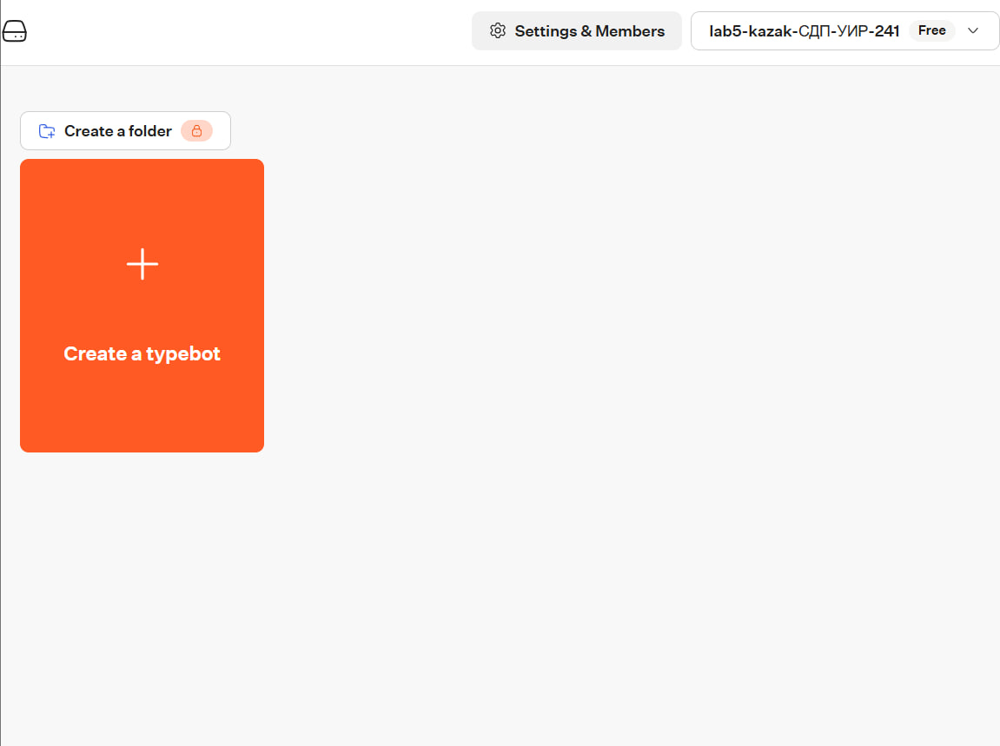

*01 — дашборд Typebot Cloud, workspace `lab5-kazak-СДП-УИР-241`, план Free. Кнопка «Create a folder» с замком: на бесплатном плане недоступна.*

### 5.2. Шаблон до изменений

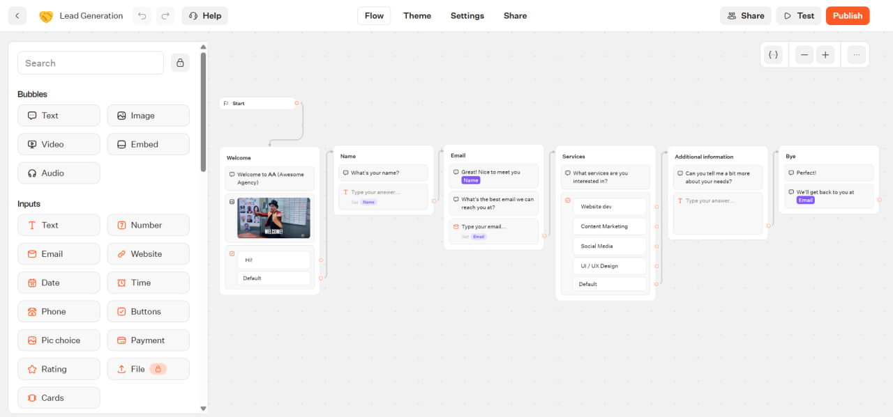

*02 — шаблон Lead Generation в исходном виде: английские тексты, шесть групп (Welcome, Name, Email, Services, Additional information, Bye), GIF в приветствии.*

### 5.3. Русификация

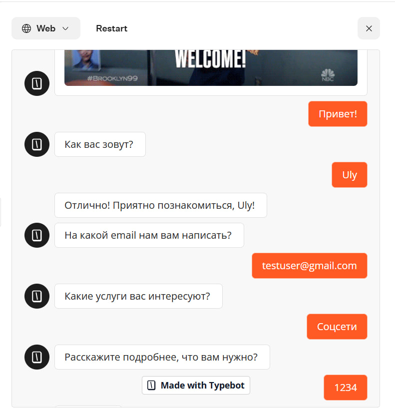

*03 — тестовый прогон после перевода: приветствие, имя, email и услуга на русском, подстановка `Name` работает.*

### 5.4. Переменные

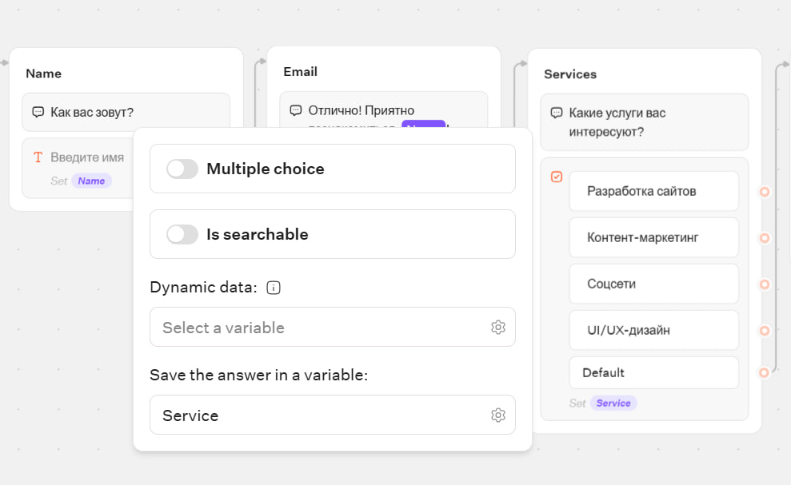

*04 — блок кнопок Services: ответ сохраняется в переменную `Service` (плашка «Set Service»).*

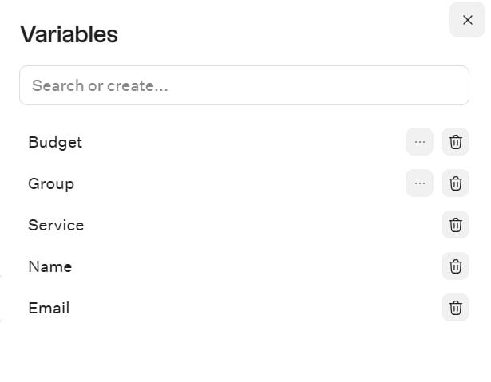

*05 — список переменных бота: Budget, Group, Service, Name, Email.*

### 5.5. Новая группа Group

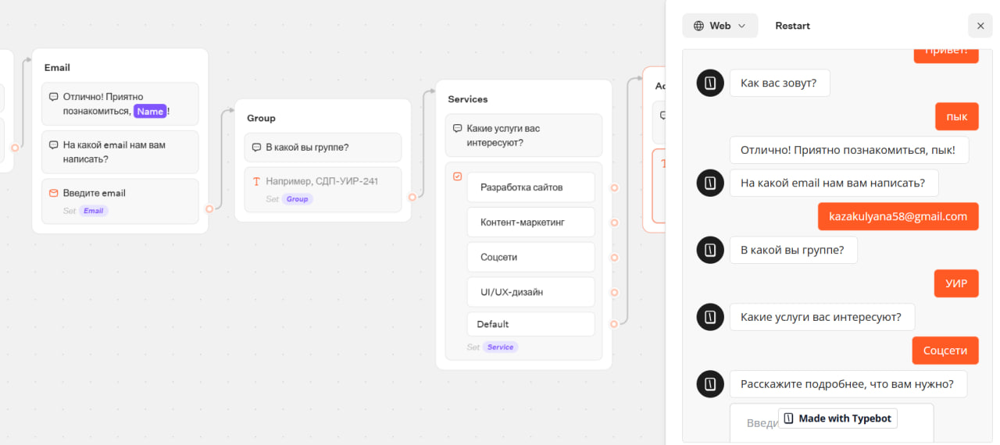

*06 — группа Group встроена между Email и Services; тест показывает вопрос «В какой вы группе?».*

### 5.6. Condition и ветвление

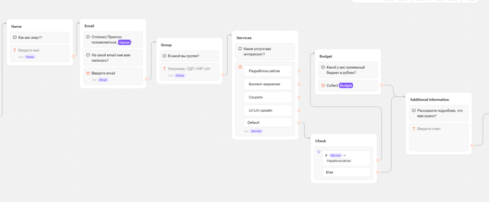
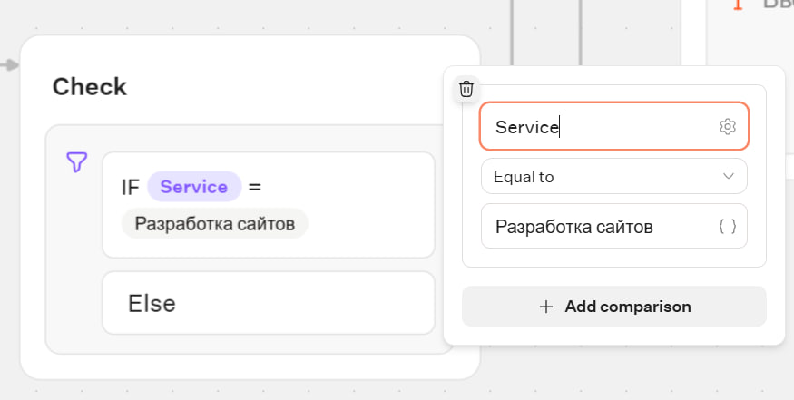

**Ветка «Разработка сайтов» (условие истинно):**

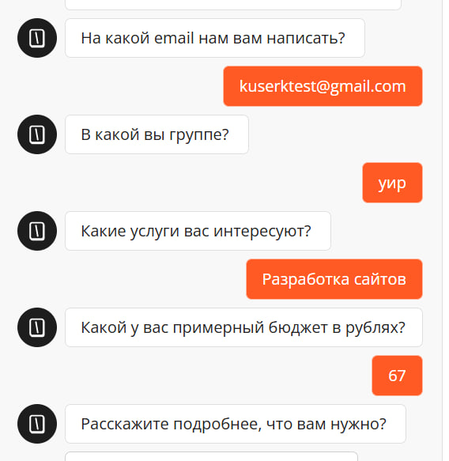

*09a — после выбора «Разработка сайтов» бот спрашивает бюджет.*

**Ветка Else («Соцсети»):**

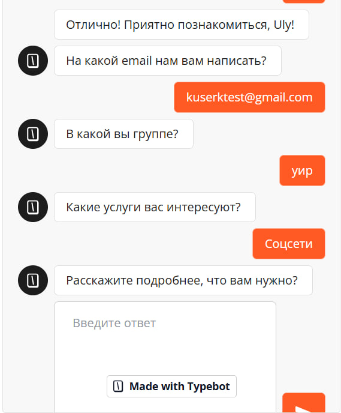

*09b — после выбора другой услуги бот пропускает вопрос о бюджете и сразу спрашивает про детали.*

### 5.7. HTTP Request

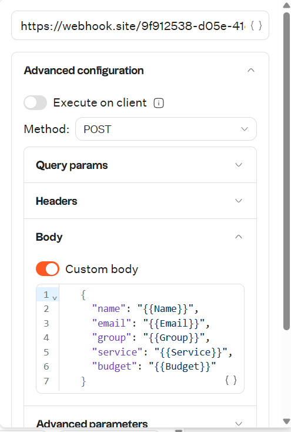

*10 — блок Send: метод POST, URL, включён Custom body с JSON.*

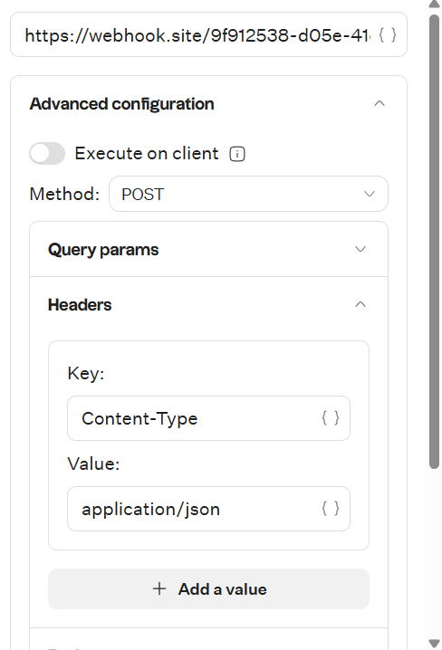

*10b — заголовок `Content-Type: application/json`.*

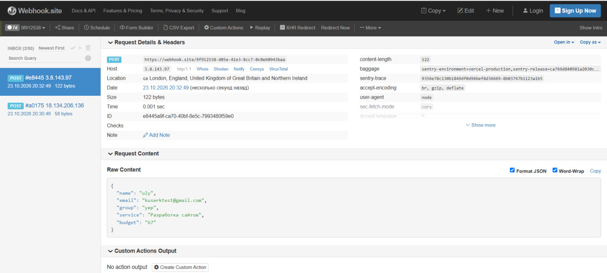

*11 — запрос пришёл на webhook.site. В теле JSON подставлены реальные значения всех пяти переменных. Второй запрос в списке (58 байт) отправлен кнопкой «Test the request» из редактора, до прохождения диалога, поэтому он короче: переменные в нём пустые.*

**Замечание:** `budget` пришёл как строка (`"67"`), потому что в теле запроса переменная записана в кавычках (`"{{Budget}}"`).

### 5.8. Тема и брендинг

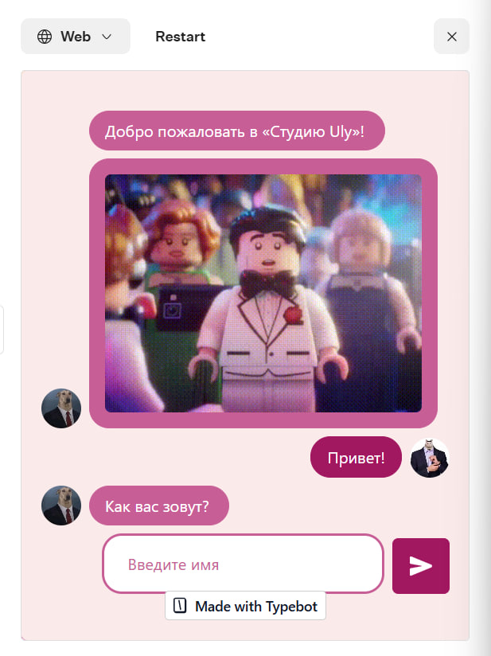

*12 — новая цветовая схема, аватары бота и пользователя, другой приветственный GIF.*

### 5.9. Опубликованный бот

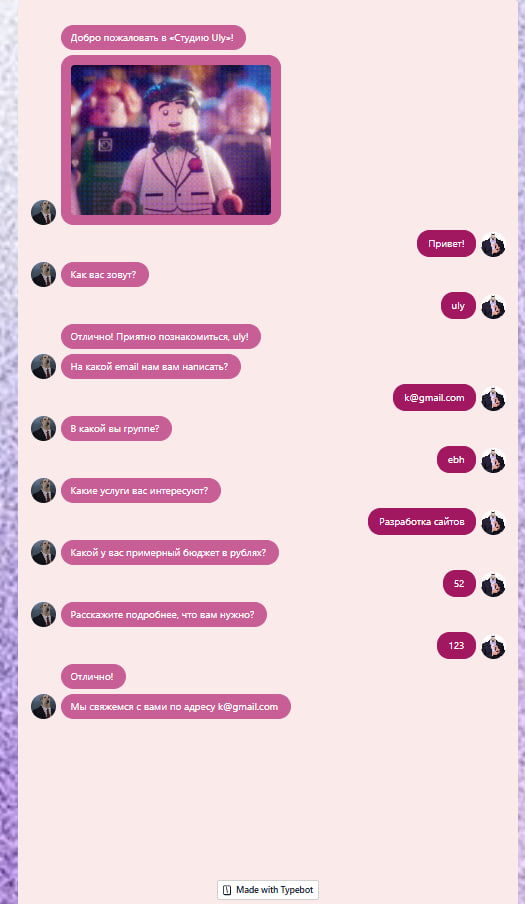

*13 — опубликованный бот, полный прогон ветки «Разработка сайтов»: от приветствия до финального сообщения с подстановкой email.*

---

## 6. Выводы

Typebot позволяет собрать диалог из блоков без кода: каждый шаг (вопрос, ввод, кнопки, условие, запрос) — отдельный блок, а связи между группами задают маршрут диалога. В бесплатнгй версии доступно 200 чатов в месяц и есть водяной знак.
