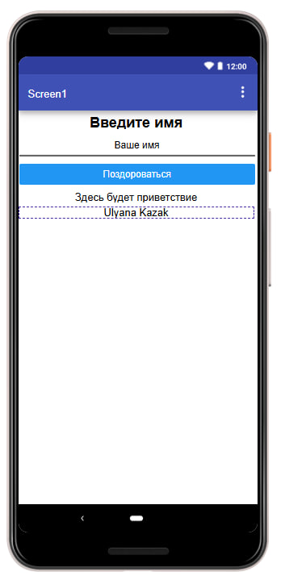
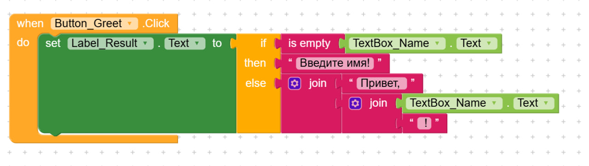
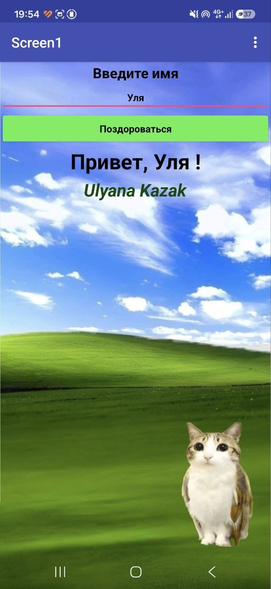

# Лабораторная работа №6. Kodular

**Студент:** Ulyana Kazak
**Группа:** [ВПИШИ ГРУППУ]

## 1. Описание приложения

Мобильное приложение «Приветствие», созданное на платформе Kodular. Пользователь вводит имя в текстовое поле и нажимает кнопку «Поздороваться». Если поле пустое, приложение выводит «Введите имя!», иначе выводит «Привет, <имя>!». На экране размещена фамилия автора (Ulyana Kazak).

Дополнительные возможности (ачивки): не реализовывались, выполнена только базовая часть.

## 2. Проект

Исходный проект: файл `lab6/exports/lab6-kazak.aia`.
Ссылка на проект в Kodular Gallery: не публиковался.

## 3. Базовая часть

### Экран (Screen1)

| Компонент | Имя | Назначение |
|---|---|---|
| Label | Label_Title | заголовок «Введите имя» |
| TextBox | TextBox_Name | поле ввода (Hint = «Ваше имя») |
| Button | Button_Greet | кнопка «Поздороваться» |
| Label | Label_Result | вывод результата |
| Label | Label_Surname | фамилия автора, Ulyana Kazak |

Дополнительно настроено: выравнивание по центру (Text Alignment, Width = Fill parent), размер и цвет шрифта, фоновое изображение экрана.

### Логика (блоки)

При нажатии на `Button_Greet` свойству `Label_Result.Text` присваивается результат условного блока `if then else`:

- `if`: блок `is empty` проверяет, пустой ли `TextBox_Name.Text`;
- `then`: возвращается текст «Введите имя!»;
- `else`: блок `join` склеивает «Привет, », имя и «!». Использованы два вложенных блока `join`.

Использован `if then else` в виде выражения (возвращает значение), а не в виде оператора. Так сделано потому, что в моей версии Kodular не удалось добавить ветку `else` в обычный блок `if` через шестерёнку.

Проверка на реальном Android-устройстве через Kodular Companion: приложение работает корректно.

[ЕСЛИ ДОБАВИШЬ ФОТО С ТЕЛЕФОНА, ВСТАВЬ СЮДА: ]

## 4. AI-промпты

Использованные запросы (отредактируй под свои реальные формулировки):

1. «Дай пошаговую инструкцию по выполнению лабораторной работы по Kodular» (общий план по заданию).
2. «Почему блок else не добавляется через шестерёнку в Kodular?» (при сборке if/else).
3. «Как экспортировать проект в формате .aia?» (экспорт проекта).
4. «Как запустить приложение через Kodular Companion?» (проверка на телефоне).
5. «Как выровнять текст в Label по центру?» (оформление экрана).

## 5. Освоенные компоненты и блоки

- Компоненты: Label, TextBox, Button, свойства Text, Hint, FontSize, Width, Text Alignment, фон Screen.
- Блоки: `when Button.Click`, `set Label.Text to`, `if then else`, `is empty`, `join`, текстовые блоки, геттер `TextBox.Text`.
- Инструменты: Kodular Companion, экспорт `.aia`.

## 6. Ограничения бесплатного тарифа

Бесплатный тариф Kodular: до 10 проектов, до 10 МБ ассетов, до 5 расширений. В этой работе [НАПИШИ ЧЕСТНО: с лимитами не столкнулась / что именно ограничило]. Фоновое изображение хранится в ассетах и занимает часть лимита 10 МБ.

## 7. Выводы

[НАПИШИ САМА 3-5 ПРЕДЛОЖЕНИЙ: что получилось, что оказалось сложным (например, добавление else и вложенные join), чем no-code отличается от обычного программирования, что понравилось или не понравилось в Kodular.]